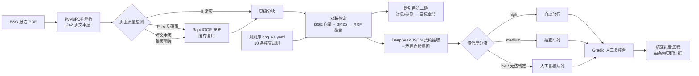

# ESG 披露核查 Agent —— 温室气体披露合规核查 PoC

> 机器初筛 + 人工复核。输入 A 股上市公司 ESG 报告 PDF，输出 10 条温室气体披露核查项的逐条判定：披露了没有、数值口径是否规范、证据在第几页。
> **声明：本工具只做披露完整性/规范性核查（L1/L2），不做数据可信度与减排合理性的实质判断（L3）——那需要审计资质，机器没有判定资格。**

## 1. 业务诊断（为什么做这个）

**监管方自己承认的问题，就是真需求。** 三个事实：

1. 2026 年是 A 股强制披露元年：上证 180 / 科创 50 / 深证 100 / 创业板指 + A+H 共 430 家强制主体，2026-04-30 前全部按期披露 2025 年度可持续发展报告（全市场 2720 家，披露率 49.8%）
2. 全市场 GHG（温室气体）排放披露率仅约 37%——大量报告这条是空的或乱的
3. 中证网 2026-03-30 报道援引专家观点：「不少报告虽指标丰富，但存在统计口径不一的问题，信息可比性仍待加强」

**受苦角色**：需要读这些报告的人——投资者关系/研究员/ESG 分析师/咨询顾问。他们的痛点不是「没有数据」，是**口径混乱导致的不可比**：同一家公司温室气体按 20 家子公司核算、其他环境数据按 18 家；范围二总数没标注是位置值还是市场值；脚注声明的方法和数据实际用的方法对不上。

**现有工具的 gap**：ESG 评级产品给的是「结果分」，不给逐条依据、不给页码、不说「这条为什么扣分」。本工具反着做：**每条结论强制附原文页码，可回溯验证**。

**口径一致性检查是典型的「人工做很枯燥、机器做很擅长」的活**：一份 100 页的报告人工对一遍要 1–2 小时且容易漏，机器逐条比对分钟级且不疲劳。

## 2. 产品定义与边界

不做什么，是产品设计，不是能力妥协：

| 层 | 判断什么 | 本工具 |
|---|---|---|
| L1 存在性 | 这条指标披露了没有 | ✅ 做（机器 100% 可判） |
| L2 规范性 | 单位/口径/边界/前后一致性 | ✅ 做（规则+机器，实测一致率 90%） |
| L3 实质性 | 数据可不可信、减排路径合不合理、是否漂绿 | ❌ 明确不做，必须审计 |

核查规则来自监管文件的结构化翻译（沪深交易所《可持续发展报告指引》+ 上交所《第二号：应对气候变化》指南 + 财政部《企业可持续披露准则第 1 号——气候》），10 条规则见 [`rules/ghg_v1.yaml`](rules/ghg_v1.yaml)，每条含：依据条款 / 检查项 / 失败条件 / 证据页码要求 / 是否需人工复核。

## 3. 系统架构



关键设计：

- **检索**：规则语言是「准则腔」、报告语言是「报表腔」，纯向量检索 recall@5 只有 53%，加同义词桥接 + BM25 混合后解决
- **OCR 按需兜底**：不全文 OCR（慢且贵），只对「重度乱码页（字体缺 ToUnicode 映射）」和「短文本页（整页图片）」启用，结果缓存
- **输出契约**：先定 JSON schema 再调模型；代码层校验 judgment 与 reason 的逻辑一致性，发现自相矛盾自动重问
- **人机边界**：置信度分层实测——high 12 条 0 错判、medium 8 条集中全部 2 条错判。错误率分层支撑分流策略，不靠拍脑袋

### 3.1 应用层（Web 服务）

```
浏览器（单页应用，原生 JS） ── HTTP JSON ──> FastAPI ──> SQLite
                                               │
                                               └─ session 鉴权（httpOnly cookie token）
```

| 层 | 实现 | 选型理由 |
|---|---|---|
| 前端 | 原生 JS 单页应用（介绍 / 核查结果 / 人工复核 / 运营看板 四视图） | 无构建步骤，POC 阶段复杂度为零 |
| 后端 | FastAPI，JSON 接口契约：`/api/login` `/api/results` `/api/review` `/api/board` | 前端不直接碰数据，所有访问走接口层 |
| 数据库 | SQLite 四张表：users / check_runs / review_actions / events | 单机、无并发、零运维；生产化换 PostgreSQL 只动 `get_conn()` |
| 鉴权 | 用户名密码（加盐哈希）+ 服务端 session token（httpOnly cookie） | 复核动作绑定账号，未登录 401 拦截 |
| 日志 | 评测管线落 `logs/audit_日期.log`；Web 层 events 表记使用行为 | 排障有据、使用可审计 |
| 部署 | 开发本机 → 演示期按量计费云服务器 3 天 | POC 不为「第二年还要用」付钱 |

**运营闭环**：登录/查结果/提交复核均记入 events 表 → 看板页聚合为使用量、复核修改率、高错判规则 Top3 → 修改率高的规则进入规则库修订候选。「使用 → 复核 → 迭代」闭环，看板不是摆设，是规则库的迭代输入。

## 4. 评测（全部实测，样本：长安汽车 + 江淮汽车 2025 年度 ESG 报告）

| 指标 | 数字 | 说明 |
|---|---|---|
| 证据页召回 | **17/17 = 100%** | 每条判定的证据都命中人工标注页码 |
| 判定一致率（迭代前） | 60% | 基线 |
| 判定一致率（迭代后） | 85% | 判定细则 + 矛盾自检 + OCR 补页 |
| 判定一致率（基准修正后） | **18/20 = 90%** | 剩 2 条为机器真错，逐条归因 |
| 检索 recall@5 | 53% → 76% | v1 → 同义词桥接 v2 |
| 置信度分层 | high 12 条 0 错 / medium 8 条 2 错 | 分流策略的实证依据 |

Ground truth 为 20 条人工标注（指标在不在、第几页、原文引用），**标注过程发现并修正了 AI 预判的 3 处错误**——包括一次人工验算推翻「脚注自相矛盾」预判，和一次人工复核修正自身双标（GHG-04）。评测是双向的：模型输出被审计，基准数据也被审计。

## 5. 关键工程决策与翻车记录（节选）

| 问题 | 定位 | 解法 |
|---|---|---|
| 长安报告绩效表数字抽出全乱码，标签正常 | 现象是「部分字符坏」→ 排除编码转换 → 推断数字字体缺 ToUnicode 映射，换库复核确认是文件缺陷 | 该类页面渲染成图走 OCR |
| Excel 保存的「csv」实为 xlsx 格式且逗号拆列 | 文件头 `PK` 识别出真实格式 | 读入后按 schema 重建基准表 |
| 检索评测首次跑出 0%，但真值明明在 top5 | 打印中间变量：top5 元素是 `(report, page)` 元组，真值是 int，比较恒 False | 修比较逻辑，复跑得真实基线 53% |
| LLM 输出 judgment=否 但 reason=「满足要求」 | 温度 0 也会字段间自相矛盾 | prompt 自查 + 代码正则检测自动重问 |
| 本地服务「能跑一次」但再次打开已死 | 端口探测确认无监听：临时后台进程被父会话连带终止 | 启动脚本固化，可复现性不靠记忆 |

## 6. 快速开始

```bash
# 1. 安装（Python 3.10+）
python -m venv venv
venv\Scripts\python -m pip install -r requirements.txt

# 2. 配置 LLM key（环境变量，不进代码）
setx DEEPSEEK_API_KEY "sk-..."

# 3. 启动 Web 应用 → 浏览器打开 http://127.0.0.1:8000
#    演示账号：demo / demo1234
venv\Scripts\python -m uvicorn app.main:app --host 127.0.0.1 --port 8000

# 4. 复现评测（检索召回 + 全量对打 + 分流导出）
venv\Scripts\python scripts\day3_retrieval_eval.py
venv\Scripts\python scripts\day4_full_eval.py
venv\Scripts\python scripts\day5_triage_export.py
```

数据来源：巨潮资讯网公开披露的报告原文（`data/reports/`，体积大不入仓库，见 .gitignore）。示例报告：长安汽车（000625）、江淮汽车（600418）2025 年度 ESG 报告。

## 7. 面试思考题（三问三答）

**Q1：客户内网不能调外部 API 怎么办？**
Embedding 已经是本地 BGE 模型（100MB，CPU 可跑，零边际成本）；LLM 一层可切换为内网私有化部署的开源模型——架构上抽出了唯一的 LLM 调用点（`judge()` 函数），换端点不动流程。

**Q2：报告是扫描件/整页图片怎么办？**
分级兜底：文本层可用走文本抽取 → 文本层弱走 OCR → OCR 后仍无法判定则标记「需人工查看原件」+ 页码，不硬猜。对核查工具，诚实说「我没读到」比编一个结果值钱。

**Q3：客户不接受 AI 出结论怎么办？**
产品本来就不是全自动的：AI 只做初筛并附页码证据，抽查/复核条目必须人工确认，底稿明确标注「机器结论不替代审计意见」。AI 的角色是把人工从「逐页翻找」降到「按证据确认」。

---

*项目性质：个人 PoC（求职作品集），非商业产品。规则库依据均为公开监管文件，示例报告来自交易所法定信息披露渠道。*
